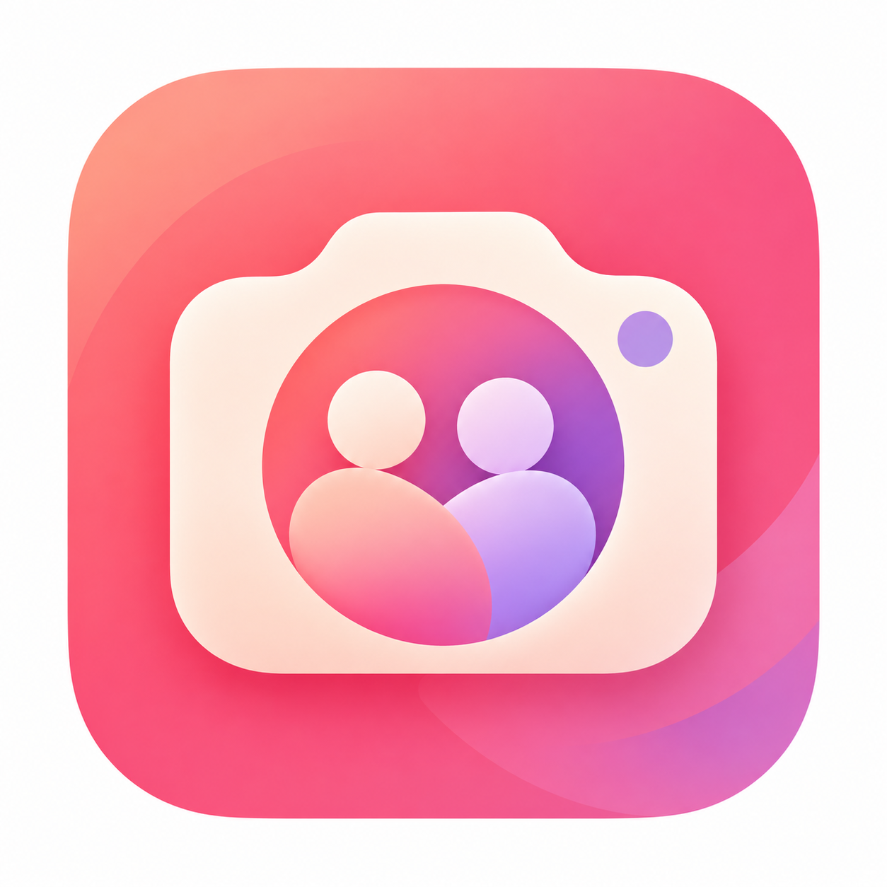
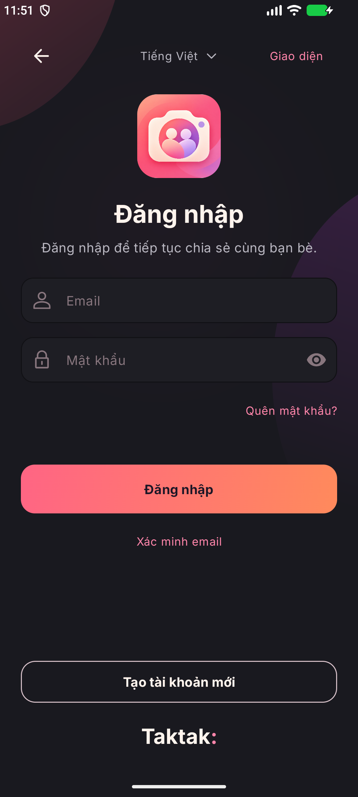
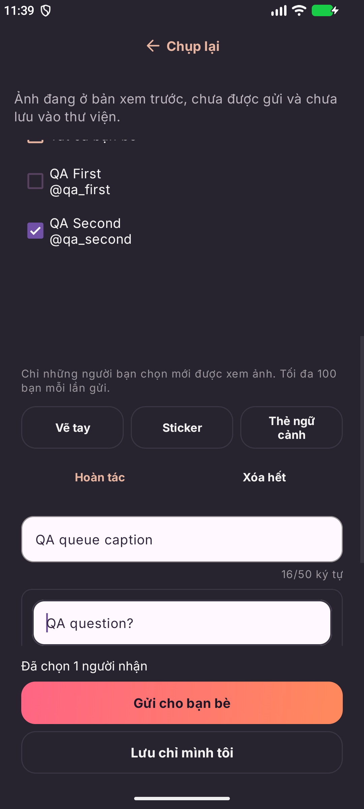
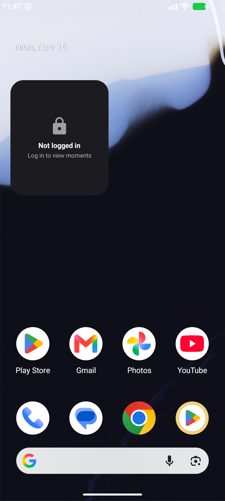

<p align="center">
  
</p>

# Taktak

**Chia sẻ khoảnh khắc, kết nối những người thân thương.**

Taktak là ứng dụng Android để chia sẻ ảnh và video ngắn với bạn bè. Chạm để chụp ảnh hoặc giữ nút chụp để quay clip tối đa 3 giây, sau đó thêm lời nhắn và chọn người nhận. Khoảnh khắc mới có thể xuất hiện trên widget màn hình chính của bạn bè.

Ứng dụng không có bảng tin công khai. Ảnh được lưu trên máy chủ riêng và chỉ người có quyền mới truy cập được qua API xác thực.

**Chụp → Xem trước → Chọn bạn → Gửi khoảnh khắc**

## Giao diện

<table>
  <tr>
    <td align="center"><br>Đăng nhập</td>
    <td align="center"><br>Chọn người nhận và tạo Poll</td>
    <td align="center"><br>Widget màn hình chính</td>
  </tr>
</table>

Ảnh chụp từ bản QA ngày 16/11/2026 trên máy ảo, dùng dữ liệu thử nghiệm.

## Tính năng

### Chụp và chia sẻ khoảnh khắc

- Chụp ảnh vuông, đổi camera trước/sau và sử dụng flash khi thiết bị hỗ trợ.
- Xem trước, chụp lại, thêm chú thích tối đa 50 ký tự hoặc trang trí bằng nét vẽ, sticker và thẻ ngữ cảnh.
- Chọn người nhận trước khi gửi hoặc lưu khoảnh khắc chỉ cho mình.
- Xem lịch sử Đã nhận/Đã gửi, mở ảnh toàn màn hình và lưu vào thư viện khi muốn.
- Xóa khoảnh khắc đã gửi; server thu hồi quyền tải ảnh ở những yêu cầu tiếp theo.

### Kết nối bạn bè

Tìm bạn bằng username hoặc mã QR. Người dùng có thể hiển thị mã cá nhân, quét bằng camera hoặc chọn ảnh QR từ thư viện; gửi, chấp nhận và từ chối lời mời kết bạn; hủy kết bạn hoặc chặn người dùng.

### Tin nhắn riêng

- Trò chuyện 1–1 với bạn bè, theo dõi tin chưa đọc và trạng thái đã đọc.
- Chia sẻ khoảnh khắc trong hội thoại.
- Trả lời ảnh đã nhận: lời nhắn xuất hiện trong cuộc trò chuyện với chủ ảnh, không hiển thị thành bình luận công khai.
- Quyền xem ảnh vẫn do server kiểm tra, kể cả khi ảnh được tham chiếu trong tin nhắn.

### Widget và thông báo

Widget 2×2 và 4×2 đưa ảnh mới nhất lên màn hình chính. Firebase Cloud Messaging báo có thay đổi, sau đó WorkManager tải nội dung bằng phiên đăng nhập và cập nhật widget.

Tốc độ cập nhật phụ thuộc kết nối mạng, quyền thông báo và chính sách chạy nền của Android/nhà sản xuất; ứng dụng không bảo đảm cập nhật tức thì sau khi bị buộc dừng.

### Tài khoản và cá nhân hóa

- Đăng ký, đăng nhập, xác minh email và khôi phục mật khẩu qua email.
- Đặt lại mật khẩu thành công thu hồi các phiên cũ.
- Cập nhật tên hiển thị và ảnh đại diện.
- Năm tab chính: Camera, Lịch sử, Tin nhắn, Bạn bè và Hồ sơ.
- Bốn phong cách Original, Gradient, Glass và Soft; hỗ trợ sáng, tối và theo hệ thống.
- Intro thương hiệu có tùy chọn bỏ qua, khởi động nhanh và âm thanh.

### Taktak AI

Trò chuyện với trợ lý Gemini trong ứng dụng, quản lý lịch sử và xóa hội thoại AI. Tính năng cần được bật và cấu hình ở backend.

Nội dung cuộc trò chuyện AI được gửi tới Google khi người dùng đồng ý. Ảnh riêng tư và tin nhắn giữa bạn bè không được tự động đưa vào cuộc trò chuyện AI. API key chỉ nằm trên server.

### Gửi khi mất mạng, camera kép và bình chọn

| Tính năng | Trải nghiệm |
|---|---|
| Offline Outbox | Hàng đợi gửi khoảnh khắc và thử lại khi kết nối trở lại |
| Dual Camera | Ghép ảnh camera trước/sau; có phương án chụp tuần tự theo khả năng thiết bị |
| Photo Poll | Gắn bình chọn hai lựa chọn vào ảnh. Người nhận bỏ phiếu, chủ ảnh có thể đóng bình chọn |
| Live Moment | Chạm để chụp, giữ để quay tối đa 3 giây hoặc thả tay để dừng sớm |

## Công nghệ và kiến trúc

| Thành phần | Công nghệ |
|---|---|
| Android | Java, XML, ViewBinding, Material Components; Android 8.0/API 26 trở lên |
| Kiến trúc client | MVVM, ViewModel, LiveData, Repository |
| API và hình ảnh | Retrofit, OkHttp, Gson, Glide |
| Camera và tác vụ nền | CameraX, WorkManager, AppWidgetProvider/RemoteViews |
| Backend | Java 17, Spring Boot 3, Spring Security, JPA, Validation |
| Database | PostgreSQL, Flyway |
| Xác thực | BCrypt, JWT access token, refresh token xoay vòng |
| Thông báo | Firebase Cloud Messaging |
| AI | Gemini API qua backend |
| Build và triển khai | Gradle Groovy, Maven, Nginx/TLS, systemd; cấu hình Docker Compose |

Android không sử dụng Kotlin hoặc Jetpack Compose. Firebase chỉ phục vụ FCM; tài khoản, dữ liệu và ảnh do backend Taktak quản lý.

```text
Android (Java/XML)
    │ HTTPS · REST API · JWT
    ▼
Spring Boot
    ├── PostgreSQL: tài khoản, quan hệ, khoảnh khắc, hội thoại
    ├── Private storage: ảnh và video
    ├── Transactional outbox → FCM → WorkManager → Widget
    ├── SMTP: xác minh email và khôi phục tài khoản
    └── Gemini: hội thoại AI có sự đồng ý của người dùng
```

Package Android: `com.taktak.app`. Package backend: `com.taktak.server`.

## Chạy dự án

Repository gồm hai project build độc lập:

```text
android-client/    Ứng dụng Android và kiểm thử
server/            Backend Spring Boot và migration
docs/              Hướng dẫn, hợp đồng API, hồ sơ kiểm thử
deploy/            Cấu hình VPS, backup và bảo trì
scripts/           Công cụ phát triển và QA
```

### Chuẩn bị trên Windows

Cài Git, Android Studio với SDK Platform 37/Platform Tools, JDK 17 cho backend và PostgreSQL. Android dùng JDK chạy Gradle tương thích với phiên bản đã khóa trong repository; script bên dưới ưu tiên JBR đi kèm Android Studio. Maven và Gradle đều có wrapper.

```powershell
git clone https://github.com/Conmeosoma/taktak-social.git
Set-Location taktak-social
```

### Backend

Tạo database và role PostgreSQL riêng cho môi trường phát triển. Tham khảo [server/.env.example](server/.env.example), rồi nạp cấu hình vào environment; Spring Boot không tự đọc file `.env`.

Ví dụ PowerShell từ thư mục gốc — thay các placeholder bằng cấu hình local:

```powershell
. .\scripts\Use-TaktakJava.ps1 -Target Server
$env:DB_URL = 'jdbc:postgresql://127.0.0.1:5432/taktak'
$env:DB_USERNAME = '<local-db-role>'
$env:DB_PASSWORD = '<set-locally>'
$env:JWT_ACCESS_SECRET = '<base64-of-at-least-32-random-bytes>'
$env:IMAGE_STORAGE_ROOT = Join-Path (Get-Location) '.local/private-images'
Set-Location server
.\mvnw.cmd spring-boot:run
```

Flyway áp migration khi khởi động. Kiểm tra kết nối ở cửa sổ PowerShell khác:

```powershell
Invoke-RestMethod http://127.0.0.1:8080/actuator/health
```

Email cần cấu hình SMTP; FCM cần Firebase Admin credentials riêng cho server; Gemini cần cấu hình AI. Khi dùng Live Moment, chuẩn bị FFmpeg/ffprobe theo [hướng dẫn xử lý video](docs/LIVE_MOMENT_VALIDATION.md).

### Android

1. Mở thư mục **android-client/** trong Android Studio, không mở thư mục gốc repository làm Gradle project.
2. Cấu hình SDK và Gradle JDK, sau đó Sync project.
3. Đặt Firebase config đúng package tại `android-client/app/google-services.json`; giữ file này ngoài Git.
4. Chạy module `app`, hoặc build từ repository root:

```powershell
. .\scripts\Use-TaktakJava.ps1 -Target Android
Set-Location android-client
.\gradlew.bat "-Dorg.gradle.java.home=$env:JAVA_HOME" `
  "-Porg.gradle.java.installations.paths=$env:JAVA_HOME" `
  -Porg.gradle.java.installations.auto-detect=false `
  -PTAKTAK_DEBUG_BASE_URL=http://10.0.2.2:8080/ assembleDebug
```

APK debug nằm tại `android-client/app/build/outputs/apk/debug/app-debug.apk`.

| Thiết bị/môi trường | API base URL |
|---|---|
| Emulator gọi backend trên máy tính | `http://10.0.2.2:8080/` |
| Điện thoại USB, sau khi chạy `adb reverse tcp:8080 tcp:8080` | `http://127.0.0.1:8080/` |
| Backend triển khai | URL HTTPS của server |
| Release build | Chạy `assembleRelease` với `-PTAKTAK_RELEASE_BASE_URL=https://<your-api-host>/`, sau đó ký APK bằng khóa phát hành |

Base URL cần dấu `/` cuối. HTTP chỉ dành cho debug local được cho phép; release bắt buộc HTTPS. `google-services.json` phía Android không phải Firebase Admin private key.

## Quyền riêng tư

Ảnh và video nằm ngoài web root, được tải qua API có xác thực và kiểm tra quyền. Server kiểm tra người gửi, người nhận, quan hệ bạn bè và chặn; việc biết ID ảnh không đủ để xem ảnh.

Mật khẩu được băm bằng BCrypt, refresh token chỉ lưu hash ở server. Push dùng để báo thay đổi, không mang nội dung ảnh hoặc tin nhắn riêng. Ứng dụng chỉ lưu ảnh vào gallery khi người dùng chọn; xóa ảnh trên server không xóa được bản đã được người nhận lưu ra ngoài ứng dụng.

## Tài liệu phát triển

| Nội dung | Tài liệu |
|---|---|
| API tài khoản và email | [Auth](docs/AUTH_API.md) · [Recovery](docs/ACCOUNT_RECOVERY.md) |
| API bạn bè, khoảnh khắc và chat | [Friends](docs/FRIEND_RELATIONS_API.md) · [Moments](docs/MOMENT_API.md) · [Chat](docs/CHAT_API.md) |
| Firebase và AI | [FCM setup](docs/FIREBASE_SETUP.md) · [Taktak AI](docs/AI_CHATBOT.md) |
| Triển khai và bảo trì | [VPS](docs/DEPLOYMENT_GUIDE.md) · [Maintenance](deploy/MAINTENANCE.md) |
| Độ tin cậy và vận hành | [Outbox](docs/RELIABILITY_OUTBOX.md) · [Observability](docs/OBSERVABILITY.md) · [Compatibility](docs/CLIENT_SERVER_COMPATIBILITY.md) |
| Quyền riêng tư | [Lưu trữ và xóa dữ liệu](docs/PRIVACY_AND_RETENTION.md) |
| Kiểm thử | [Chuẩn bị QA](docs/QA_BOOTSTRAP.md) · [Trạng thái dự án](docs/PROJECT_STATUS.md) |

Backend có thể kiểm thử bằng `mvnw.cmd verify` trong `server/` với JDK 17. Android có các tác vụ `testDebugUnitTest`, `lintDebug` và instrumentation trên emulator/thiết bị. Dùng database và tài khoản QA riêng; xem hướng dẫn của từng suite trước khi chạy.

Các báo cáo QA ghi rõ phạm vi và thời điểm kiểm thử. Source có tính năng không đồng nghĩa tính năng đó đã được triển khai hoặc nghiệm thu trên mọi thiết bị/VPS.

## Nhóm phát triển

**Nhóm 3**

- Nguyễn Xuân Trường
- Nguyễn Nam Tiến
- Nguyễn Hữu Đức
- Nguyễn Công Thuần
- Tống Việt Hà

## Đóng góp

Tham khảo [quy ước dự án](AGENTS.md) và [quyết định kỹ thuật](docs/PROJECT_DECISIONS.md) trước khi thay đổi. Gửi pull request với mô tả và kết quả kiểm thử liên quan; không đưa credentials, Firebase Admin JSON, keystore hoặc cấu hình bí mật vào Git.

Repository chưa có file LICENSE quy định quyền sử dụng và phân phối.
