<p align="center">
  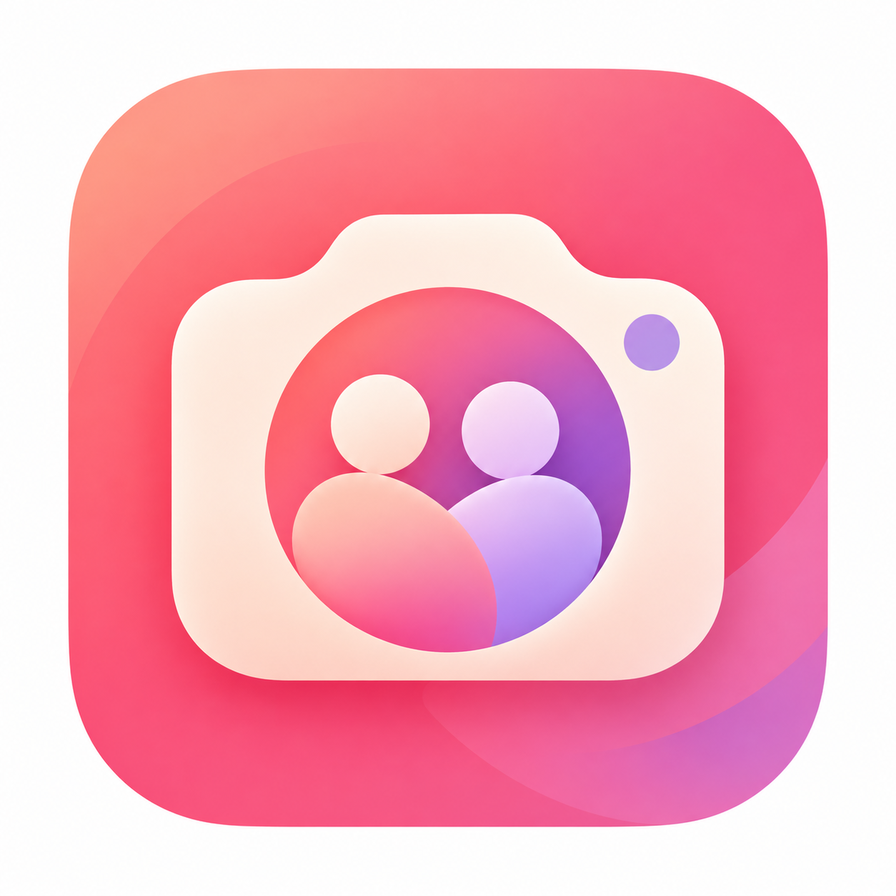
</p>

# Taktak

**Chia sẻ khoảnh khắc, kết nối những người thân thương.**

Taktak là ứng dụng Android dành cho những nhóm bạn muốn chia sẻ cuộc sống thường ngày trong một không gian riêng tư. Chụp một tấm ảnh, chọn người nhận và gửi đi; ảnh mới nhất có thể xuất hiện trên widget màn hình chính của bạn bè mà không cần mở ứng dụng.

Không có bảng tin công khai. Ảnh được lưu trên máy chủ riêng và chỉ truy cập qua API có xác thực, theo quyền người gửi/người nhận.

**Chụp → Xem trước → Chọn bạn → Chia sẻ → Widget**

[Ảnh ứng dụng](#ảnh-ứng-dụng) · [Chạy local](#chạy-local-trên-windows) · [API](#api) · [Kiểm thử](#kiểm-thử) · [Triển khai](#triển-khai)

## Ảnh ứng dụng

<table>
  <tr>
    <td align="center"><a href="docs/screenshots/login.png">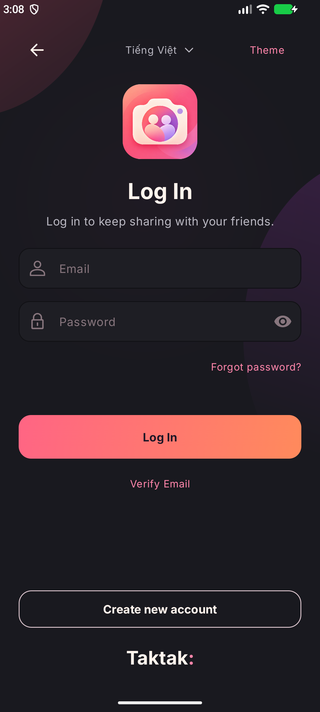</a><br>Đăng nhập</td>
    <td align="center"><a href="docs/screenshots/register.png">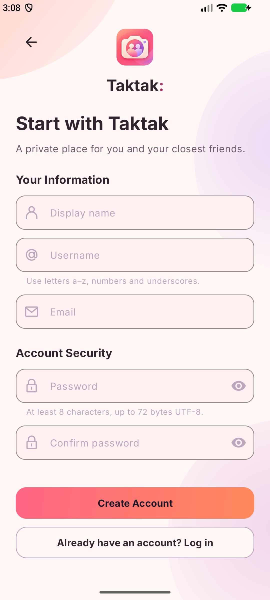</a><br>Đăng ký</td>
    <td align="center"><a href="docs/screenshots/preview.png">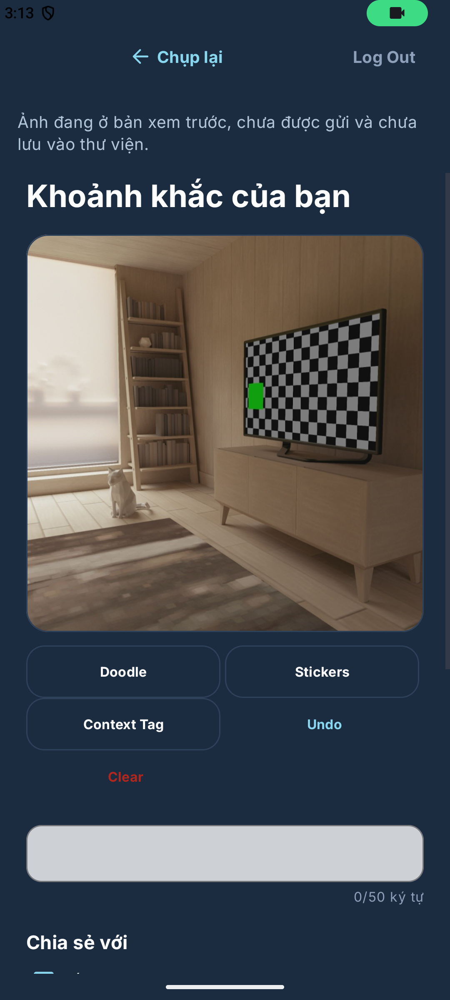</a><br>Chụp → Preview · cảnh ảo</td>
  </tr>
  <tr>
    <td align="center"><a href="docs/screenshots/history-received.png">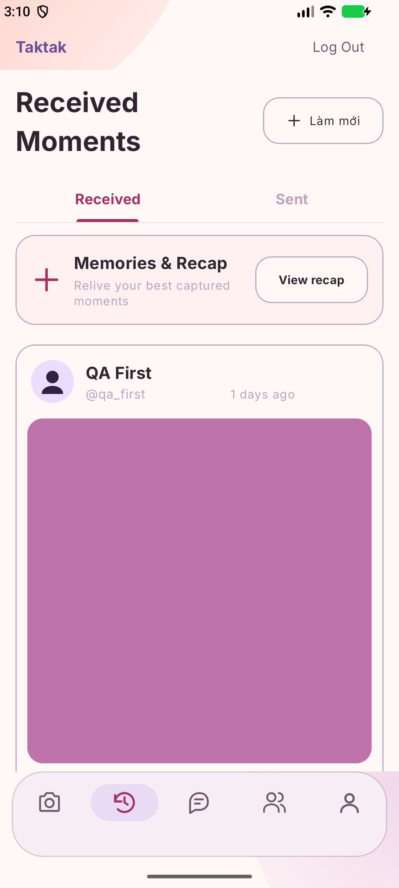</a><br>Ảnh đã nhận · QA</td>
    <td align="center"><a href="docs/screenshots/friends.png">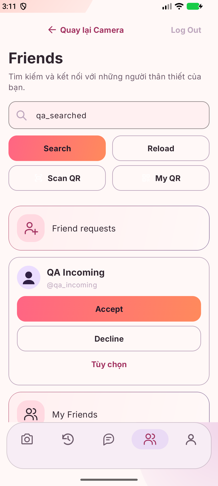</a><br>Bạn bè · QA</td>
    <td align="center"><a href="docs/screenshots/profile.png">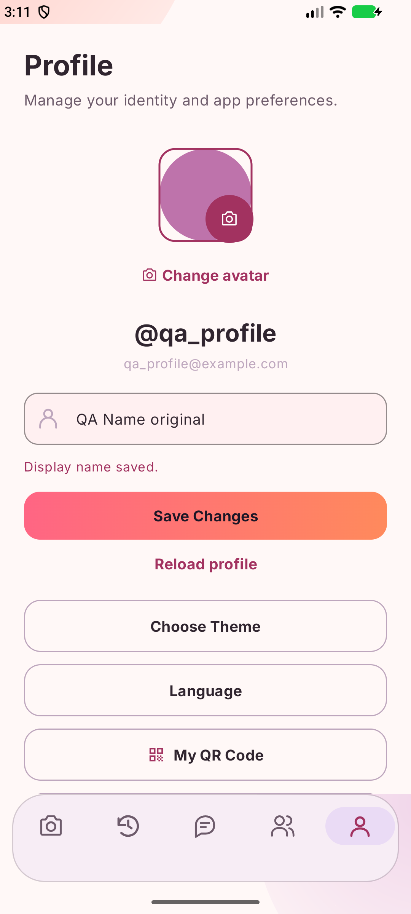</a><br>Hồ sơ · QA</td>
  </tr>
  <tr>
    <td align="center"><a href="docs/screenshots/messages.png">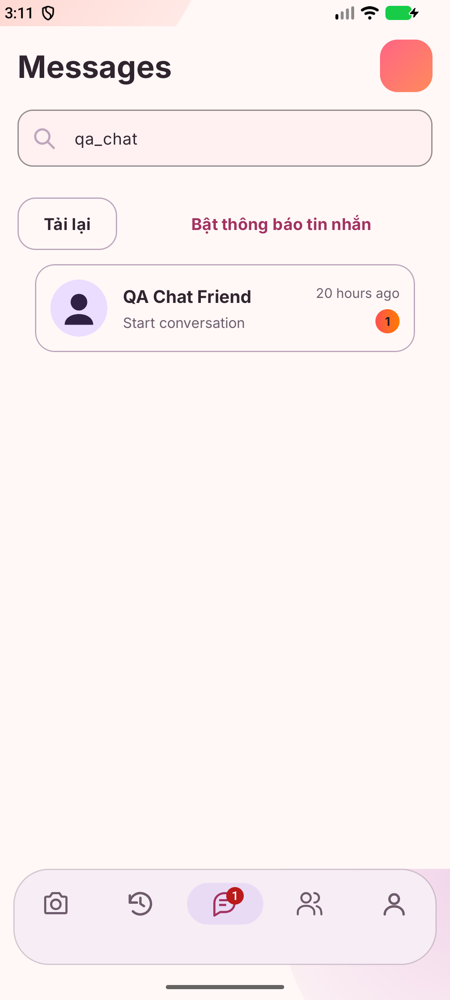</a><br>Tin nhắn · QA</td>
    <td align="center"><a href="docs/screenshots/photo-reply.png">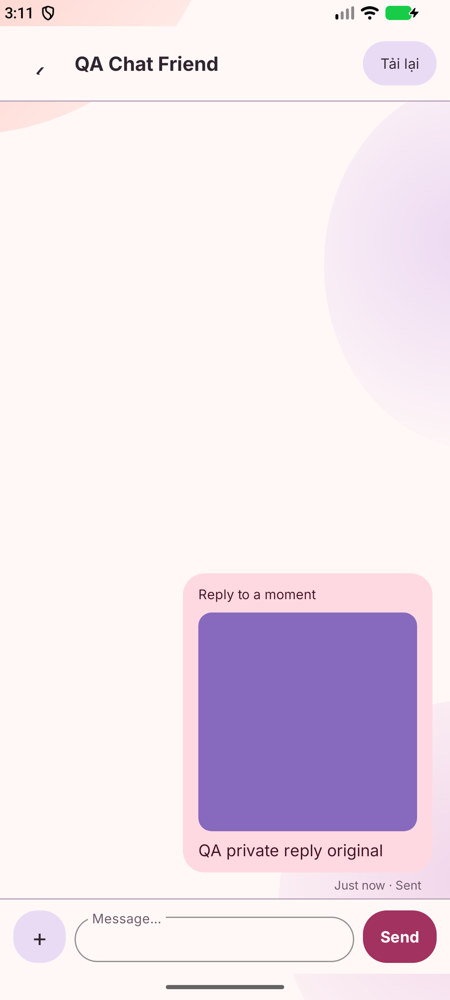</a><br>Trả lời ảnh · QA</td>
    <td align="center"><a href="docs/screenshots/widget-signed-out.png">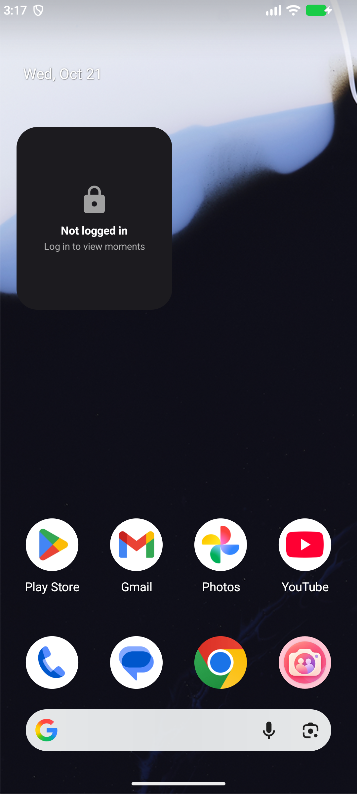</a><br>Widget 2×2 · chưa đăng nhập</td>
  </tr>
</table>

<details>
<summary>Xem thêm: lịch sử gửi, recovery, theme, QR và trạng thái Camera</summary>

<table>
  <tr>
    <td align="center"><a href="docs/screenshots/history-sent.png">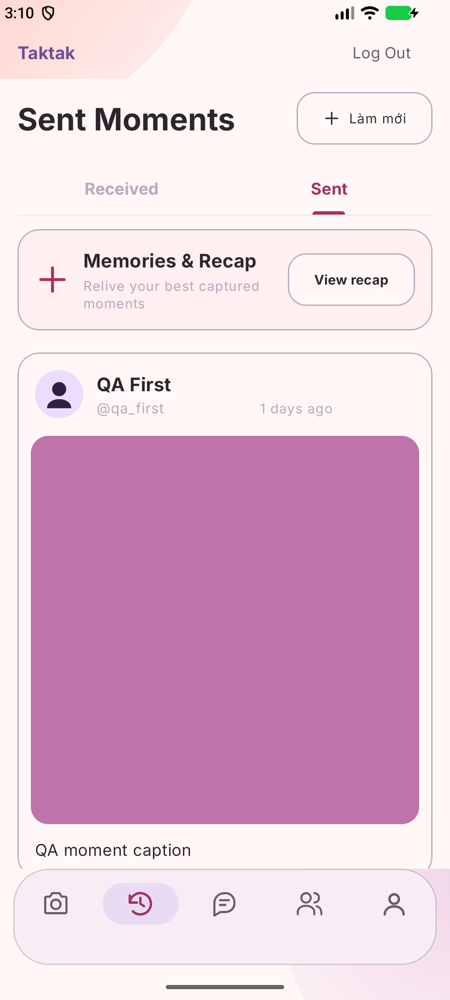</a><br>Ảnh đã gửi · QA</td>
    <td align="center"><a href="docs/screenshots/forgot-password.png">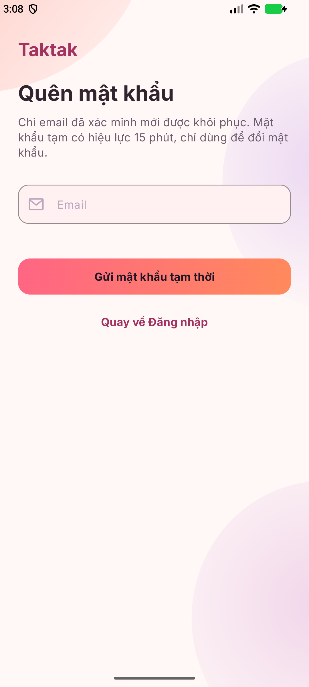</a><br>Quên mật khẩu</td>
    <td align="center"><a href="docs/screenshots/verify-email.png">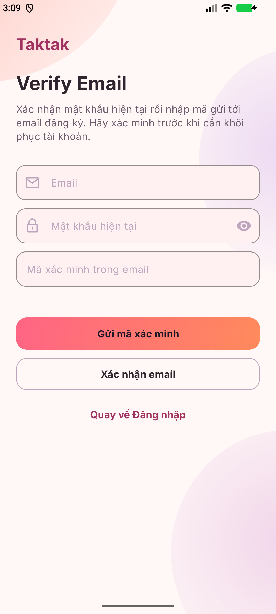</a><br>Xác minh email</td>
  </tr>
  <tr>
    <td align="center"><a href="docs/screenshots/theme-picker.png">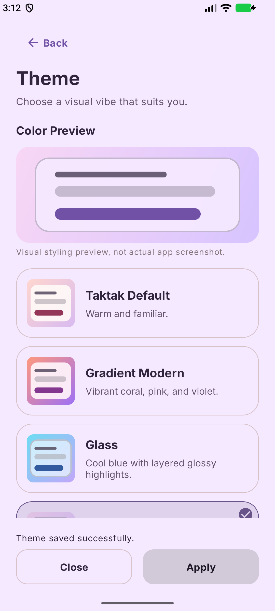</a><br>Chọn theme</td>
    <td align="center"><a href="docs/screenshots/my-qr.png">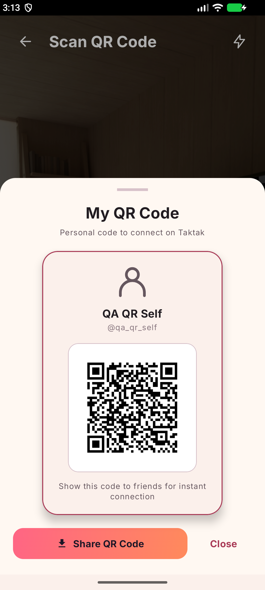</a><br>QR cá nhân · QA</td>
    <td align="center"><a href="docs/screenshots/camera-starting.png">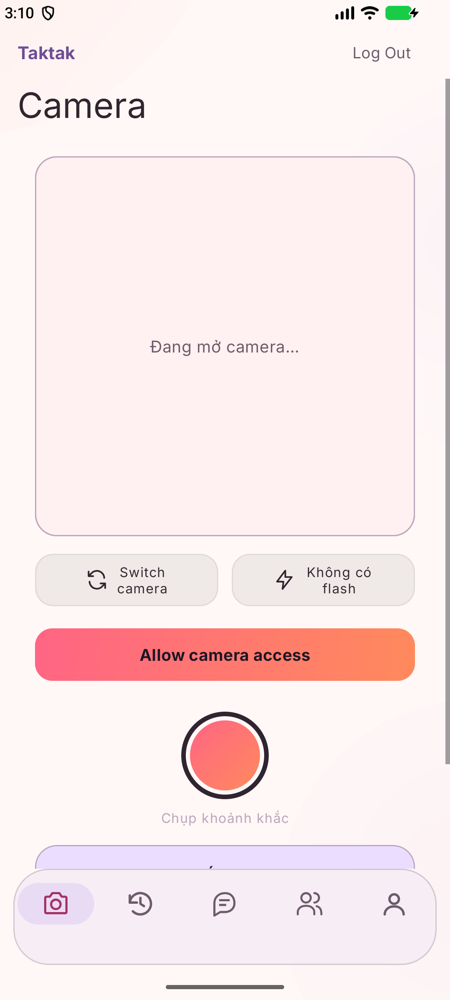</a><br>Camera · đang khởi tạo</td>
  </tr>
</table>

</details>

Ảnh chụp trực tiếp ứng dụng trên Android Emulator, không phải concept hoặc mockup. Tên, hội thoại và ảnh trong các màn đã đăng nhập là dữ liệu QA giả lập; gallery minh họa giao diện, không chứng minh SMTP, FCM hoặc VPS đã hoạt động thực tế.

## Tính năng

### Chia sẻ ảnh riêng tư

- CameraX: chụp ảnh vuông, đổi camera và chọn chế độ flash khi phần cứng hỗ trợ.
- Xem trước, chụp lại, caption tối đa 50 ký tự Unicode và chọn người nhận.
- Gửi cho một hoặc nhiều bạn; chế độ chỉ mình tôi không phát thông báo cho người khác.
- Nén ảnh mục tiêu 500–800 KB, tiến trình upload và thử lại với mã chống gửi trùng.
- Lịch sử Đã nhận/Đã gửi, phân trang, mở ảnh và lưu vào thư viện khi người dùng chọn.
- Người gửi được xóa ảnh; server từ chối các yêu cầu tải mới sau khi ảnh bị xóa.

### Bạn bè và trò chuyện

- Tìm theo username, gửi/chấp nhận/từ chối lời mời, hủy bạn và chặn người dùng.
- Mã QR cá nhân, quét camera hoặc chọn ảnh QR để tìm người dùng.
- Chat riêng 1–1 giữa bạn bè: văn bản, tham chiếu khoảnh khắc, trạng thái đã đọc và số tin chưa đọc.
- Trả lời ảnh đã nhận ngay trong trình xem; bình luận xuất hiện trong cuộc trò chuyện với chủ ảnh, không phải bình luận công khai.
- Chat không cấp thêm quyền xem ảnh. Khi ảnh bị thu hồi, nội dung trả lời vẫn được giữ nhưng tham chiếu ảnh không còn khả dụng.

### Tài khoản và giao diện

- Đăng ký, đăng nhập, duy trì phiên bằng access JWT và refresh token xoay vòng.
- Xác minh email, yêu cầu mật khẩu tạm và đặt lại mật khẩu. Reset thành công thu hồi mọi refresh token và vô hiệu JWT cũ ở yêu cầu tiếp theo.
- Hồ sơ cá nhân, chỉnh tên hiển thị, tải avatar và đăng xuất.
- Năm tab: Camera / Lịch sử / Tin nhắn / Bạn bè / Hồ sơ.
- Bốn phong cách Original, Gradient, Glass và Soft; sáng/tối/theo hệ thống, chọn và xem trước theme.

### Widget và thông báo

- Có AppWidgetProvider/RemoteViews cho widget 2×2 và 4×2.
- FCM báo thay đổi; WorkManager tải lại ảnh có xác thực và cập nhật widget. Có đồng bộ định kỳ dự phòng.
- Cập nhật nền phụ thuộc Android, mạng và chính sách pin/OEM; không bảo đảm tức thì, đặc biệt sau force-stop.
- Hiệu ứng reaction widget hiện là phản hồi cục bộ, chưa phải gửi reaction đến bạn bè qua server.

### Trạng thái xác minh

Nội dung được đối chiếu với workspace ngày 21/10/2026. Source, README và ảnh QA
được người dùng duyệt đưa lên `main`; việc xuất bản mã nguồn không đồng nghĩa
bản đang chạy trên VPS đã được cập nhật hoặc nghiệm thu production.

| Phần | Trạng thái của workspace |
|---|---|
| Auth, bạn bè, chia sẻ ảnh, lịch sử, hồ sơ | Có triển khai và bằng chứng kiểm thử local/UI trong [hồ sơ QA](docs/PROJECT_STATUS.md) |
| Chat và trả lời ảnh riêng | Đã kiểm thử backend/local, AVD và USB; chưa nghiệm thu toàn luồng reply qua VPS/FCM thật |
| Recovery qua email | Code và test fixture có sẵn; Gmail thật còn bị chặn ở xác thực SMTP trong lần nghiệm thu được ghi nhận |
| FCM/widget | Có SDK, server sender và worker; không suy ra delivery thực tế từ ảnh giao diện |
| UI toàn ứng dụng | Còn lỗi bản dịch/lint và một số ca layout/hồi quy chưa ổn định; không coi toàn app đã PASS |
| Production | README không xác nhận bản đang chạy trên VPS trùng với workspace này |

Giới hạn chi tiết: [trả lời ảnh](docs/QA_MOMENT_REPLY.md), [khôi phục tài khoản](docs/ACCOUNT_RECOVERY.md), [audit UI/UX](docs/UI_UX_AUDIT.md), [QA widget](docs/QA_WIDGET_SYNC.md).

## Công nghệ

Phiên bản lấy từ cấu hình trong repository, không phải tuyên bố phiên bản mới nhất.

| Thành phần | Công nghệ | Vai trò |
|---|---|---|
| Android | Java 17, XML, ViewBinding | Native UI; minSdk 26, compile/targetSdk 37 |
| UI | Material Components 1.14.0, AppCompat 1.8.0 | Theme, form, dialog, điều hướng |
| Kiến trúc client | ViewModel/LiveData 2.11.0, Repository | MVVM, trạng thái và dữ liệu |
| HTTP/JSON | Retrofit 3.0.0, OkHttp 5.5.0, Gson 2.14.0 | API và xử lý response |
| Ảnh/camera | Glide 5.0.9, CameraX 1.6.2 | Hiển thị và chụp ảnh |
| Nền/widget | WorkManager 2.12.0, AppWidgetProvider/RemoteViews | Đồng bộ và widget |
| Phiên/QR | EncryptedSharedPreferences 1.1.0, ZXing 3.5.3 | Phiên mã hóa, mã QR |
| Backend | Java 17, Spring Boot 3.5.16, Spring Security/JPA/Validation | API, nghiệp vụ và phân quyền |
| Database | PostgreSQL, Flyway | Dữ liệu quan hệ, migration V1–V5 |
| Push | Firebase Messaging BoM 35.0.1; Admin SDK 9.4.3 | Tín hiệu ảnh và chat |
| Build | Gradle Groovy 9.6.0 / AGP 9.4.1; Maven Wrapper 3.9.16 | Hai project build độc lập |
| Triển khai | Nginx/TLS, systemd; phương án Docker Compose | Cấu hình và script trong deploy/ |

Compose chọn PostgreSQL `16-alpine`; không coi phiên bản native mặc nhiên giống image Docker. Android không dùng Kotlin hoặc Jetpack Compose. Firebase **chỉ dùng FCM**, không dùng Auth, Firestore, Storage hoặc Cloud Functions; không có chatbot AI.

## Kiến trúc

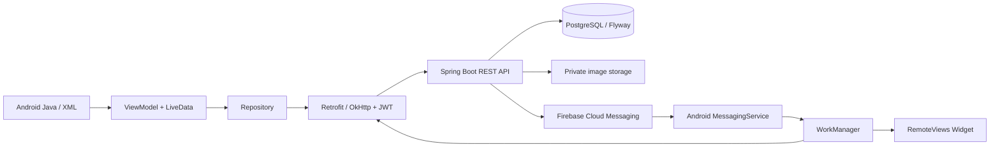

Client đăng nhập, gửi ảnh và danh sách người nhận qua API. Server kiểm tra quyền, quan hệ bạn bè/block, xử lý ảnh và ghi metadata vào PostgreSQL; file ảnh nằm ngoài web root. Sau commit, FCM báo thay đổi. Máy nhận tải lại dữ liệu bằng phiên hợp lệ; push không chứa ảnh, caption, nội dung chat hay credential và không tự cấp quyền truy cập.

Package Android/applicationId: `com.taktak.app`. Package backend: `com.taktak.server`.

## Cấu trúc repository

```text
taktak/
├── android-client/     Java/XML, Gradle Wrapper, kiểm thử Android
├── server/             REST API, Maven Wrapper, Flyway, integration tests
├── docs/               Hợp đồng API, quyết định, hướng dẫn, báo cáo QA
├── deploy/             Nginx, systemd, Docker, script bảo trì/backup
├── scripts/            Chọn JDK, smoke test và nghiệm thu trên Windows
├── AGENTS.md           Quy ước phát triển và giới hạn an toàn
└── README.md
```

## Chạy local trên Windows

### 1. Chuẩn bị

- Git và PowerShell.
- JDK **17 cho backend**. Android dùng Gradle JDK tương thích AGP/Gradle đang khóa, qua Android Studio; source level Java 17 không đồng nghĩa JDK chạy Gradle phải là 17.
- Android Studio, SDK Platform **37**, Platform Tools; emulator/system image hoặc thiết bị Android **8.0/API 26** trở lên.
- PostgreSQL đang chạy với database/role local dành riêng cho phát triển.
- Maven/Gradle có wrapper; không cần bản toàn cục nếu wrapper tải được dependency.

```powershell
git clone https://github.com/Conmeosoma/taktak-social.git
Set-Location taktak-social
```

Kiểm tra `git branch --show-current` và source của bạn; không cần tự chuyển sang một nhánh cố định.

### 2. Backend

Tạo database local `taktak` và role riêng bằng công cụ PostgreSQL bạn sử dụng. Role cần quyền tạo schema/bảng trong database đó để Flyway chạy. Không dùng database production để thử.

Tham khảo [server/.env.example](server/.env.example), rồi nạp cấu hình vào environment. **Spring Boot không tự đọc file .env.** Ví dụ dưới là placeholder cần thay bằng giá trị local, không commit giá trị thật:

```powershell
. .\scripts\Use-TaktakJava.ps1 -Target Server
$env:DB_URL = 'jdbc:postgresql://127.0.0.1:5432/taktak'
$env:DB_USERNAME = '<local-db-role>'
$env:DB_PASSWORD = '<set-locally>'
$env:JWT_ACCESS_SECRET = '<base64-of-at-least-32-random-bytes>'
$env:IMAGE_STORAGE_ROOT = Join-Path (Get-Location) '.local/private-images'
Set-Location server
.\mvnw.cmd spring-boot:run
```

Helper chọn JDK 17 từ `.tools/` nếu có, nếu không dùng `JAVA_HOME`; không tự cài JDK. JWT secret phải là Base64 của ít nhất 32 byte ngẫu nhiên, không phải chuỗi ví dụ. Server từ chối secret không hợp lệ.

Flyway tự áp migration khi khởi động, Hibernate dùng `validate`, không `update`. Chỉ trỏ tới database dev đã kiểm tra. Ở cửa sổ khác:

```powershell
Invoke-RestMethod http://127.0.0.1:8080/actuator/health
```

Kỳ vọng `status=UP`. Local mặc định bind `127.0.0.1:8080` và tắt FCM server; kiểm tra API cơ bản không cần Admin key.

### 3. Android

1. Mở `android-client/` bằng Android Studio, chuẩn bị SDK 37 và Gradle JDK phù hợp.
2. Đăng ký Firebase Android app đúng package `com.taktak.app`; đặt config local tại `android-client/app/google-services.json`. Không đưa file này vào Git.
3. Đặt SDK path qua Android Studio/`local.properties`. Repo hiện có đường dẫn JDK máy phát triển trong `gradle.properties`; kiểm tra và override cho máy của bạn.
4. Từ repository root, chạy:

```powershell
. .\scripts\Use-TaktakJava.ps1 -Target Android
Set-Location android-client
.\gradlew.bat "-Dorg.gradle.java.home=$env:JAVA_HOME" `
  "-Dorg.gradle.java.installations.paths=$env:JAVA_HOME" `
  -Dorg.gradle.java.installations.auto-detect=false `
  -PTAKTAK_DEBUG_BASE_URL=http://10.0.2.2:8080/ assembleDebug
```

Helper Android chọn JBR của Android Studio nếu có. APK: `app/build/outputs/apk/debug/app-debug.apk`. Chạy module `app` bằng Android Studio hoặc cài bằng `adb install -r <apk-path>`.

| Môi trường | Kết nối backend |
|---|---|
| Emulator | `http://10.0.2.2:8080/` trỏ về máy host |
| Điện thoại USB | `adb -s <serial> reverse tcp:8080 tcp:8080`, build với `http://127.0.0.1:8080/` |
| LAN/tunnel | Dùng HTTPS; cấu hình hiện tại không cho HTTP tới IP LAN tùy ý |
| Release | Bắt buộc `-PTAKTAK_RELEASE_BASE_URL=https://<your-api-host>/`; cần cấu hình ký riêng để phân phối |

URL phải có dấu `/` cuối. HTTP debug chỉ cho emulator/loopback, không dùng trên mạng công cộng. `localhost` trên điện thoại không phải máy tính nếu chưa có ADB reverse.

### 4. FCM và email

- `google-services.json` là config client, **khác** Admin service-account JSON chứa private key phía server. Cả hai giữ local theo chính sách repo.
- [Firebase setup](docs/FIREBASE_SETUP.md): bật FCM và đăng ký token. Prod dùng `FCM_ENABLED`/`GOOGLE_APPLICATION_CREDENTIALS`; chỉ bật khi đã chuẩn bị quyền đọc credential.
- Recovery cần SMTP STARTTLS. Gmail dùng App Password phù hợp chính sách tài khoản, không dùng mật khẩu đăng nhập thường. Xem [ACCOUNT_RECOVERY.md](docs/ACCOUNT_RECOVERY.md).
- Thiếu SMTP không đồng nghĩa gửi thư thành công; không dùng tài khoản cá nhân cho test reset.

### Biến cấu hình chính

| Biến | Mục đích | Bắt buộc |
|---|---|---|
| `DB_URL`, `DB_USERNAME`, `DB_PASSWORD` | PostgreSQL | Backend |
| `JWT_ACCESS_SECRET` | Ký access JWT; Base64 ≥32 byte | Backend |
| `JWT_ACCESS_MINUTES`, `JWT_REFRESH_DAYS` | Thời hạn token | Mặc định 15 phút/30 ngày |
| `IMAGE_STORAGE_ROOT` | Thư mục ảnh private ngoài web root | Có mặc định local; cấu hình rõ khi triển khai |
| `SERVER_ADDRESS`, `SERVER_PORT` | Bind local; profile prod khóa address loopback | Có mặc định |
| `FCM_ENABLED` | Bật Admin sender trong prod | Local mặc định tắt; prod có mặc định riêng |
| `GOOGLE_APPLICATION_CREDENTIALS` | Admin JSON chỉ server đọc | Khi bật FCM |
| `MAIL_HOST`, `MAIL_PORT`, `MAIL_USERNAME`, `MAIL_PASSWORD`, `MAIL_FROM` | SMTP STARTTLS | Khi dùng xác minh/recovery email |
| `TRUSTED_PROXY_REGEX` | Proxy tin cậy trong prod | Khi thay topology proxy mặc định |

`TAKTAK_DEBUG_BASE_URL` / `TAKTAK_RELEASE_BASE_URL` là **Gradle properties** (`-P`), không phải biến backend.

## API

API nghiệp vụ cần Bearer JWT và kiểm tra quyền server. Bảng rút gọn từ controller:

| Method | Endpoint | Mục đích / xác thực |
|---|---|---|
| POST | `/api/auth/register`, `/api/auth/login` | Tạo tài khoản/đăng nhập; không yêu cầu access JWT |
| GET | `/api/auth/check-username` | Username khả dụng; public, response no-store |
| POST | `/api/auth/refresh`, `/api/auth/logout` | Refresh credential trong body; không cần access JWT còn hạn |
| POST | `/api/auth/verification/request`, `/api/auth/verification/confirm` | Mật khẩu hiện tại và mã xác minh theo từng bước |
| POST | `/api/auth/forgot-password`, `/api/auth/reset-password` | Recovery; reset cần credential dùng một lần |
| GET / PUT | `/api/users/me` | Hồ sơ của mình; JWT |
| POST / GET | `/api/users/me/avatar` | Tải lên/đọc avatar của mình; JWT |
| GET | `/api/users/{id}/avatar` | Avatar theo quyền server; JWT |
| GET | `/api/users/search` | Tìm username, lọc block; JWT |
| GET / POST | `/api/friends/requests` | Lời mời đến/gửi lời mời; JWT |
| PUT | `/api/friends/requests/{id}` | Chấp nhận/từ chối; JWT người nhận |
| GET / DELETE | `/api/friends`, `/api/friends/{id}` | Danh sách/hủy bạn; JWT |
| POST / DELETE | `/api/blocks/{userId}` | Chặn/bỏ chặn; JWT |
| POST / GET | `/api/moments` | Upload multipart/lịch sử; JWT |
| GET | `/api/moments/latest`, `/api/moments/{id}/image` | Ảnh mới nhất/tải ảnh được phép; JWT |
| DELETE | `/api/moments/{id}` | Xóa ảnh; chỉ sender |
| GET / POST | `/api/devices` | Danh sách/đăng ký thiết bị; JWT |
| DELETE | `/api/devices/{deviceId}` | Bỏ đăng ký thiết bị của mình; JWT |
| GET | `/api/conversations`, `/api/conversations/{id}` | Inbox/chi tiết; JWT thành viên và quan hệ hợp lệ |
| POST | `/api/conversations/with-friend/{friendId}` | Mở chat với bạn; JWT |
| GET / POST | `/api/conversations/{id}/messages` | Đọc/gửi TEXT, MOMENT, MOMENT_REPLY; JWT |
| PUT | `/api/conversations/{id}/read` | Đánh dấu đã đọc; JWT |

Schema, validation và mã lỗi: [Auth](docs/AUTH_API.md), [Recovery](docs/ACCOUNT_RECOVERY.md), [Friends](docs/FRIEND_RELATIONS_API.md), [Moments](docs/MOMENT_API.md), [Chat](docs/CHAT_API.md), [Errors](docs/API_ERRORS.md).

## Kiểm thử

Từ repository root, dùng JDK đúng cho từng project:

```powershell
. .\scripts\Use-TaktakJava.ps1 -Target Server
Push-Location server
.\mvnw.cmd verify
Pop-Location

. .\scripts\Use-TaktakJava.ps1 -Target Android
Push-Location android-client
.\gradlew.bat "-Dorg.gradle.java.home=$env:JAVA_HOME" `
  "-Dorg.gradle.java.installations.paths=$env:JAVA_HOME" `
  -Dorg.gradle.java.installations.auto-detect=false `
  -PTAKTAK_DEBUG_BASE_URL=http://10.0.2.2:8080/ `
  testDebugUnitTest assembleDebug assembleDebugAndroidTest
Pop-Location
```

Integration tests server dùng PostgreSQL nhúng; không cần trỏ test vào DB production. Trên AVD QA riêng, sau khi cài app và test APK:

```powershell
adb -s '<avd-serial>' shell am instrument -w -r `
  -e taktak.allowReplyQa true `
  -e class com.taktak.app.ui.theme.MomentReplyUiTest `
  com.taktak.app.test/androidx.test.runner.AndroidJUnitRunner
```

Không chạy toàn bộ instrumentation tùy tiện trên điện thoại có tài khoản cá nhân: từng suite có fixture/opt-in riêng. Xem [QA bootstrap](docs/QA_BOOTSTRAP.md). Lần đầu cần mạng tải dependency; chỉ dùng `--offline` khi cache đầy đủ.

Bằng chứng trước lượt viết tài liệu: server **170/170**, JVM **122/122**, build debug/test/release unsigned đạt; UI reply USB **7/7**. Đây là kết quả lưu trong [QA_MOMENT_REPLY.md](docs/QA_MOMENT_REPLY.md), **không phải toàn bộ suite vừa chạy lại để viết README**. Lint được ghi nhận còn **179 lỗi** bản dịch; không có tuyên bố coverage hoặc badge CI xanh.

Lượt chụp README ngày **21/10/2026**: AVD Medium_Phone API 37, 1080×2400;
**9/9 ca UI chính đạt (213,849s)** và **3/3 ca bổ sung đạt (72,178s)**.
Tận dụng suite có sẵn, không sửa source hoặc build lại ở lượt tài liệu này.
Widget 2×2 được thêm qua launcher thật, ảnh chỉ xác nhận trạng thái chưa đăng nhập;
Camera trong ảnh riêng đang khởi tạo, còn ảnh Preview là kết quả chụp cảnh ảo
vào cache qua CameraX. Không gửi ảnh ra Internet hoặc lưu gallery.
Log local ignored: `.local/artifacts/readme-screenshots-avd-final.log` và
`readme-screenshots-extra.log`. Lượt đầu dùng sai cấu hình userdata làm user
RUNNING_LOCKED, 8 ca không đạt; đã giữ log `readme-screenshots-avd.log`, sửa
đường dẫn file userdata QA rồi chạy lại. Không coi lỗi môi trường đó là PASS.
Các lệnh khởi động backend mới/SMTP/VPS ở hướng dẫn trên chỉ được đối chiếu
tĩnh trong lượt README, chưa chạy lại; Mermaid chưa được render trực tiếp trên GitHub.

## Bảo mật và quyền riêng tư

- Mật khẩu BCrypt; server chỉ lưu hash refresh token. Reset tăng security version để từ chối JWT cũ ở request mới.
- Kiểm tra sender/recipient, bạn bè và block; không public image URL.
- Kiểm tra định dạng ảnh thực tế và xử lý trước lưu private; xóa thu hồi truy cập mới.
- Phiên Android mã hóa; release chặn cleartext, yêu cầu HTTPS.
- Không tự lưu gallery. Push không mang credential hoặc nội dung riêng tư.
- Không đưa .env, config Firebase, Admin JSON, keystore hoặc mật khẩu SMTP vào Git/log/README.

Các cơ chế này không thay thế security review/nghiệm thu triển khai; không cam kết an toàn tuyệt đối.

## Triển khai

Bắt đầu với [runbook bảo trì hiện hành](deploy/MAINTENANCE.md), sau đó [hướng dẫn triển khai VPS](docs/DEPLOYMENT_GUIDE.md) và [hướng dẫn sử dụng VPS Ubuntu](docs/HUONG_DAN_SU_DUNG_VPS_UBUNTU.md). Repository có Nginx/TLS/systemd và phương án Docker Compose.

Chuẩn bị domain/TLS, database private, user non-root, secret ngoài Git, quyền thư mục ảnh và backup đã thử phục hồi. Không chạy setup/update/restore chỉ để xem demo. Update có thể áp Flyway; rollback JAR không tự đảo schema.

Runbook native/Docker có giới hạn nghiệm thu riêng. Reply cần backend V5 và client tương thích; không tự áp migration production hoặc khẳng định VPS đã cập nhật.

## Hướng phát triển

- **Đã triển khai:** tài khoản, ảnh, bạn bè, hồ sơ, theme, chat, trả lời ảnh và nền tảng FCM/widget.
- **Đang hoàn thiện:** lint/bản dịch, layout/hồi quy đã ghi nhận và nghiệm thu môi trường triển khai.
- **Cổng còn thiếu:** Gmail inbox thật, reply hai tài khoản qua backend mới, FCM delivery tương ứng và diễn tập vận hành/khôi phục.

Roadmap chi tiết: [đặc tả](docs/TAKTAK_PROJECT.md), [PROJECT_STATUS](docs/PROJECT_STATUS.md), [TASKS](docs/TASKS.md), [SESSION_HANDOFF](docs/SESSION_HANDOFF.md). Không suy ra phần trăm hoàn thành từ số module.

## Nhóm phát triển

**Nhóm 3**

1. Nguyễn Xuân Trường
2. Nguyễn Nam Tiến
3. Nguyễn Hữu Đức
4. Nguyễn Công Thuần
5. Tống Việt Hà

## Đóng góp

Đọc [AGENTS.md](AGENTS.md) và [PROJECT_DECISIONS.md](docs/PROJECT_DECISIONS.md). Giữ Java/XML, định danh và stack đã khóa; làm thay đổi nhỏ có kiểm thử, không đưa secret vào Git. Quy ước nhánh: `feat/`, `fix/`, `docs/`, `chore/`. Đề xuất gửi pull request để review; đây không phải branch protection đã được xác minh.

## Giấy phép và liên hệ

Chưa tìm thấy LICENSE; không mặc định dự án có giấy phép MIT hay giấy phép mã nguồn mở khác.

<!-- TODO: Bổ sung thông tin giấy phép sử dụng -->
<!-- TODO: Bổ sung email liên hệ chính thức -->
